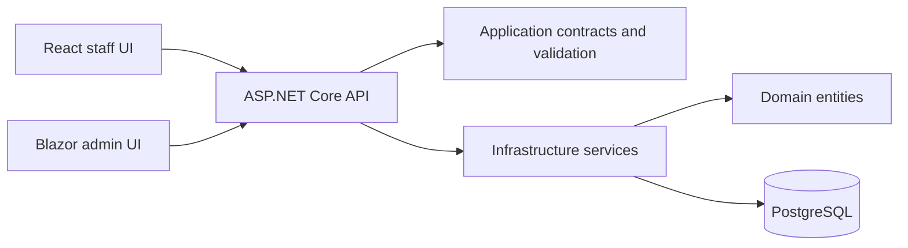

# AutoMaster CRM

AutoMaster CRM is a demonstration system for an automotive service business. It has a C#/.NET API, PostgreSQL persistence, a React/TypeScript staff interface, and a separate Blazor admin project. The repository includes customers, vehicles, work orders, mechanics, bookings, warehouse, finance, analytics, and marketing endpoints. The diagnostic assistant is a local keyword/rule engine; it is not a machine-learning model.

## Architecture



## Local setup

Requires .NET SDK 10, Node.js 22+, and PostgreSQL. Create a disposable local PostgreSQL database and supply `ConnectionStrings__DefaultConnection` and `Jwt__Key` (at least 32 bytes) as environment variables. The checked-in `CHANGE_ME` values are placeholders.

```powershell
dotnet restore backend/AutoMaster.slnx
dotnet run --project backend/AutoMaster.API
npm --prefix frontend ci
npm --prefix frontend run dev
```

The React client defaults to `http://localhost:5050/api`; set `VITE_API_URL` if the API listens elsewhere. Enable synthetic demo records only on a local development database with `Seed__DemoData=true`. `POST /api/admin/reset-demo` additionally requires `Seed__AllowDemoReset=true` and Development environment; it deletes demo tables. Never enable it on a database containing real records. No production administrator is bootstrapped automatically; provision users through a controlled local process before deployment.

## Verification

```powershell
dotnet build backend/AutoMaster.API/AutoMaster.API.csproj
dotnet test backend/AutoMaster.Tests/AutoMaster.Tests.csproj
npm --prefix frontend run build
npm --prefix frontend run lint
```

The root solution also includes the Blazor admin interface. A full Windows build may require registry and WebAssembly task-server access. Integration, load, browser, and recovery tests remain to be performed. Real screenshots have not yet been captured.

## Security and status

The API validates JWT configuration at startup, uses authentication by default, and defines role restrictions for controllers. Demo accounts use fixed credentials in source and are for disposable local data only. API behavior and data safety require additional integration testing before production use. See [known limitations](docs/KNOWN_LIMITATIONS.md), [security](docs/SECURITY.md), [setup](docs/SETUP.md), [testing](docs/TESTING.md), and [architecture](docs/ARCHITECTURE.md).

**Status: development / portfolio demonstration.**
