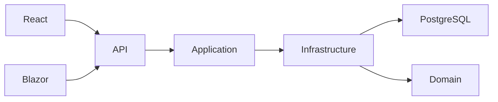

# Architecture

The API controllers in `backend/AutoMaster.API/Controllers` call interfaces from `AutoMaster.Application`. Implementations and EF Core context live in `AutoMaster.Infrastructure`; entities and enums live in `AutoMaster.Domain`. The staff UI is in `frontend`, while `AutoMaster.Admin` is a Blazor admin client.

The API applies EF migrations during startup through `DbSeeder.SeedAsync`. This couples startup availability to database migration success. Order numbers currently use a count-based sequence in `OrderService.CreateOrderAsync`, which can collide under concurrency; the unique index catches duplicates but does not recover the request. Concurrent order completion can also double-credit loyalty because there is no atomic database transition guard. These require transaction and database integration tests before production.
